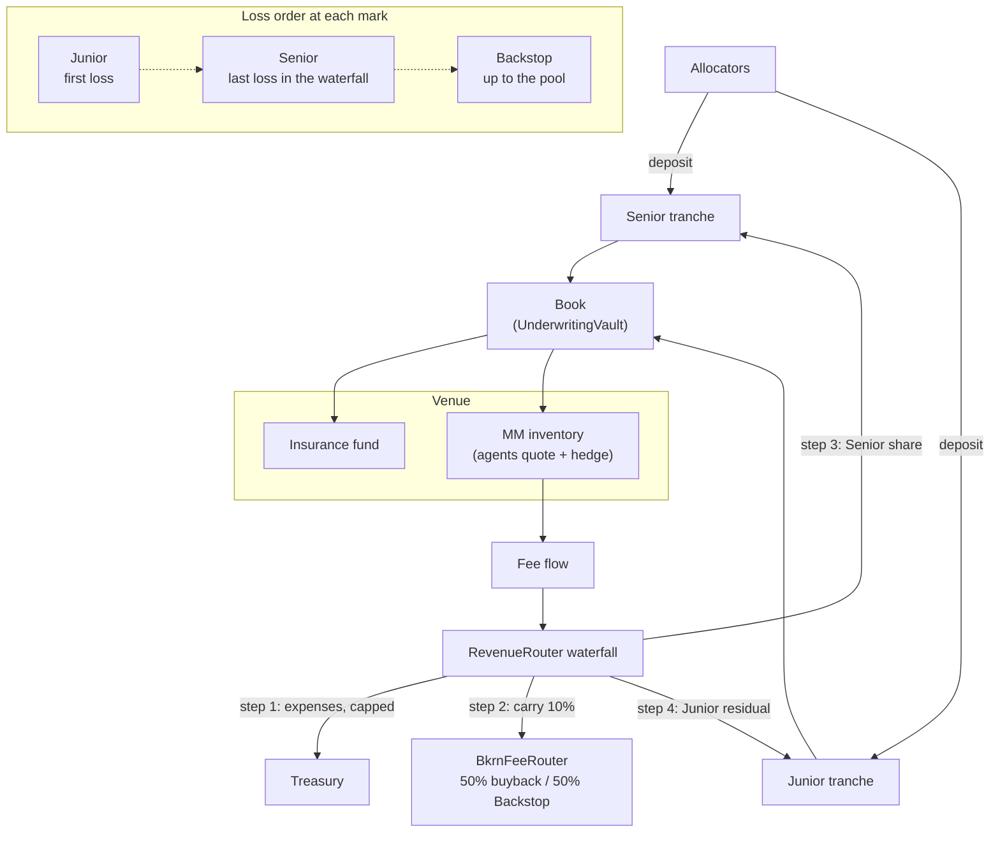
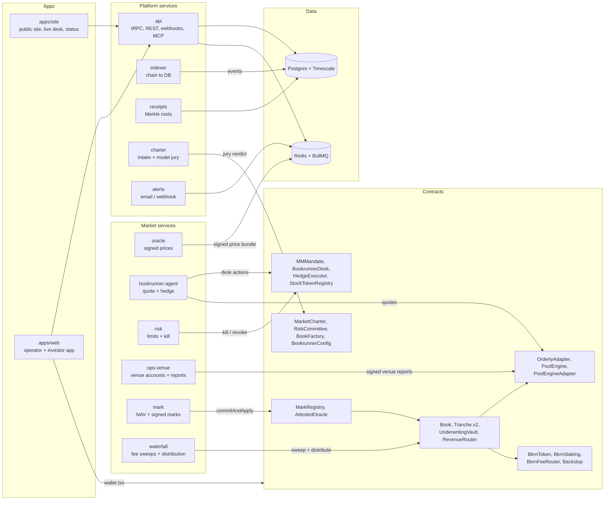

<div align="center">


# Bookrunner

### Run the book.

The underwriting syndicate for on-chain perp markets.

[](contracts/foundry.toml)
[](https://book.getfoundry.sh/)
[](https://bun.sh/)
[](tsconfig.base.json)
[](https://bookrunner.tech/status/)
[](#disclaimer)
[](LICENSE)
[](https://x.com/TryBookRunner)

[Website](https://bookrunner.tech) · [App](https://bookrunner.tech/app/) · [Live desk](https://bookrunner.tech/dashboard/) · [Status](https://bookrunner.tech/status/) · [Docs](#documentation) · [X](https://x.com/TryBookRunner)

</div>

<p align="center">
  
</p>

> [!IMPORTANT]
> **Testnet only.** Bookrunner runs on Robinhood Chain testnet with test tokens and no real funds. The
> contracts have had an internal security review; an independent external audit is planned before mainnet.

## What is Bookrunner

Every perp market needs someone to put up its insurance fund and its market-making inventory. Bookrunner
turns that job into a **book**: capital allocators subscribe to a Senior or a Junior tranche, the book
capitalises one market on a venue, bookrunner agents quote and hedge it under a mandate enforced in code, and
the book earns the market's fee flow. Every book publishes NAV, inventory, P&L and limit utilisation, and every
mark is a signed, receipt-rooted statement. Stock perps first, on Robinhood Chain.

**How it works**

1. **Charter a market.** A sponsor files a `MarketCharter` (underlying, venue, oracle plan, sessions,
   insurance-fund size, market-making mandate, tranche terms). The Risk Committee (a model-jury verdict plus
   three bonded members, 2-of-3) approves or rejects it. An approved charter becomes a book.
2. **Subscribe to the book.** Allocators deposit into two tranches. **Senior** has first claim on fee flow up to
   its share and takes the last loss in the waterfall. **Junior** takes the residual fee flow and the first loss.
   Allocation is pro-rata with a per-wallet cap, and the sponsor holds at least 10% of Junior.
3. **Capitalise the market.** The book deploys the insurance fund and market-making inventory to its venue: a
   builder market listed on Orderly's public contracts, or the in-house pool-vs-trader engine (`PoolEngine`).
4. **Agents quote it.** Bookrunner agents quote and hedge under an `MMMandate` (width, skew, inventory, hedge
   band, off-hours rule, drawdown kill). On-chain legs are validated in code; venue quoting is monitored and keys
   are revoked on breach.
5. **Earn the fee flow.** Each period, `RevenueRouter` runs the waterfall: expenses, then protocol carry (10%),
   then the Senior share, then the Junior residual. Losses run the other way: Junior, then Senior, then the
   backstop up to the pool.

### Capital and fee flow



### Architecture



The design keeps an idle book close to zero gas ([docs/LOW_GAS.md](docs/LOW_GAS.md)): prices are pulled (signed
off-chain and carried in the transaction that needs them), venue reports are signed off-chain and folded into
the mark, and each book needs one atomic mark transaction per period (`MarkRegistry.commitAndApply`).

## Live testnet

| | |
|---|---|
| Public site | https://bookrunner.tech |
| App | https://bookrunner.tech/app/ |
| Live book desk | https://bookrunner.tech/dashboard/ |
| Status page | https://bookrunner.tech/status/ (JSON: https://bookrunner.tech/status.json) |
| Chain | Robinhood Chain testnet, chain id `46630` (mainnet: chain id `4663`) |

Three books run on testnet:

| Book | Underlying | Venue path |
|---|---|---|
| NVDA | Stock Token NVDA | Orderly adapter (`PERP_NVDA_USDC`) against a simulated Orderly venue |
| TSLA | Stock Token TSLA | Orderly adapter (`PERP_TSLA_USDC`) against a simulated Orderly venue |
| RHX5 | Index of NVDA, TSLA, AAPL, MSFT, AMZN (20% each) | In-house `PoolEngine` (`RHX5-PERP`) |

What you can do there: connect a wallet and switch to the testnet, take test ETH from the
[Robinhood Chain faucet](https://faucet.testnet.chain.robinhood.com), mint test USDC in the app, subscribe to a
Senior or Junior tranche, follow NAV, marks, limits, fills and hedges per book, verify a mark's receipts proof,
and watch mark age, risk state and the last distribution per book on the status page.

Testnet uses protocol-owned mock tokens (USDC, Stock Tokens), a mock swap router, a simulated Orderly venue
and synthetic oracle prices. Live Orderly, real Stock Tokens and real price sources are the mainnet path
(`scripts/dev.ts --network mainnet`).

## Repository layout

| Path | Purpose |
|---|---|
| [`contracts/src`](contracts/src) | Protocol contracts (Solidity 0.8.30, OpenZeppelin 5.7): charters, committee, factory, books, tranches, vaults, mandates, desk, marks, oracle, venues, BKRN |
| [`contracts/src/interfaces`](contracts/src/interfaces) | Frozen cross-contract interfaces and `BRTypes` |
| [`contracts/src/libraries`](contracts/src/libraries) | `BookLogic` (linked library), `Waterfall`, `UniswapV3Twap` |
| [`contracts/src/mocks`](contracts/src/mocks) | Devnet / testnet mocks (never deployed to mainnet) |
| [`contracts/test`](contracts/test) | Foundry unit, fuzz, invariant and integration tests; [`audit/`](contracts/test/audit) holds the security-review regression tests |
| [`contracts/script`](contracts/script) | `Deploy` (devnet / testnet), `DeployMainnet`, `VerifyHandover`, `UpgradeBook`, `UpgradeOrderlyAdapters` |
| [`contracts/deploy-inputs`](contracts/deploy-inputs) | Mainnet deploy input schema and example (`4663.example.json`) |
| [`contracts/lib`](contracts/lib) | Vendored `forge-std`, OpenZeppelin contracts and contracts-upgradeable |
| [`packages/shared`](packages/shared) | Types, units, normative waterfall and mandate math, sessions codec, EIP-712, Merkle receipts, signers, generated ABIs |
| [`packages/db`](packages/db) | Drizzle schema, migrations, Timescale hypertables |
| [`services/oracle`](services/oracle) | Multi-source price collection, session holds, index levels, EIP-712 signed price bundles |
| [`services/mark`](services/mark) | Per-period NAV, inventory and receipts roots, signed marks (`commitAndApply`) |
| [`services/risk`](services/risk) | Live limit classification, breach detection and the kill sequence |
| [`services/bookrunner-agent`](services/bookrunner-agent) | One agent per book: quoting within the mandate, hedge planner, trader simulator |
| [`services/ops-venue`](services/ops-venue) | Orderly builder flow: accounts, funding, withdrawals, signed venue reports, fee settlement, key revocation |
| [`services/mock-orderly`](services/mock-orderly) | Local Orderly REST simulator for devnet and testnet |
| [`services/waterfall`](services/waterfall) | Fee sweeps, `RevenueRouter.distribute`, keeper duties, BKRN buybacks |
| [`services/receipts`](services/receipts) | Merkle roots over quote, fill, hedge and decision receipts |
| [`services/charter`](services/charter) | Charter intake API and the model jury verdict |
| [`services/indexer`](services/indexer) | Reorg-safe chain-to-database indexer for every protocol event |
| [`services/api`](services/api) | Hono + tRPC v11, REST mirror, signed webhooks, read-only MCP, public `/status` |
| [`services/alerts`](services/alerts) | Email / webhook alerting (marks, risk, processes, gas, RPC, indexer, venue reports, backups) |
| [`apps/web`](apps/web) | Investor and operator app (Vite, React 19, wagmi), served at `/app/` |
| [`apps/site`](apps/site) | Public site, live book desk (`/dashboard/`) and status page (`/status/`) |
| [`scripts`](scripts) | Foundry wrapper, deploy scripts, local orchestrator, ABI / vector generators, copy linter, ops tools (below) |
| [`deploy/server`](deploy/server) | Testnet and mainnet host install: systemd units, nginx, hardening, backups, restore |
| [`config/chains`](config/chains) | Chain price config for mainnet (Stock Tokens and price feeds) |
| [`docs`](docs) | Architecture, low-gas design, runbook, VERIFY register, bounty scope ([index](#documentation)) |

<details>
<summary><b>Scripts</b></summary>

| Script | Purpose |
|---|---|
| [`forge.sh`](scripts/forge.sh) | Runs Foundry (forge / cast / anvil) in Docker against `contracts/` |
| [`deploy-local.sh`](scripts/deploy-local.sh) | Devnet deploy: core contracts, ABIs, launch books |
| [`deploy-testnet.sh`](scripts/deploy-testnet.sh) | Robinhood Chain testnet (46630) deploy of the core |
| [`deploy-mainnet.sh`](scripts/deploy-mainnet.sh) | Mainnet (4663) deploy + governance handover, then `VerifyHandover`; `REHEARSAL=1` on testnet |
| [`dev.ts`](scripts/dev.ts) | Orchestrator: every service, one agent per book and the web app; `--network testnet / mainnet` profiles |
| [`launch-devnet.ts`](scripts/launch-devnet.ts) | Charters and launches the NVDA, TSLA and RHX5 books on devnet / testnet |
| [`gen-abi.ts`](scripts/gen-abi.ts) | Generates typed ABIs into `packages/shared/src/abi` |
| [`gen-vectors.ts`](scripts/gen-vectors.ts) | Generates waterfall parity vectors for the Solidity tests |
| [`check-copy.ts`](scripts/check-copy.ts) | Copy linter for user-facing text |
| [`check-pools.ts`](scripts/check-pools.ts) | Read-only hedge-route and pool liquidity check |
| [`record-books.ts`](scripts/record-books.ts) | Appends on-chain books to the deployment record (mainnet) |
| [`open-topup.ts`](scripts/open-topup.ts) | Opens a top-up deposit round on a live book (sponsor) |
| [`remandate.ts`](scripts/remandate.ts) | Re-mandates a killed book through the committee |
| [`gas-keeper.ts`](scripts/gas-keeper.ts), [`gas-report.ts`](scripts/gas-report.ts), [`gas-snapshot.ts`](scripts/gas-snapshot.ts) | Test-chain key refills, on-chain gas report, per-key gas snapshots |
| [`network-profile.ts`](scripts/network-profile.ts) | Network profiles and the mainnet preflight used by `dev.ts` |

</details>

## Quick start (local devnet)

Requirements: Docker (Postgres + Timescale, Redis, anvil and Foundry all run in containers) and Node.js for the
one-time Bun bootstrap.

```bash
npx -y bun@1.4.2 install                      # bootstraps Bun + workspace dependencies
docker compose up -d                          # Postgres+Timescale :54400, Redis :63790, anvil :8547
./node_modules/.bin/bun run db:migrate
./node_modules/.bin/bun run deploy:local      # forge script Deploy + ABIs (books launch on first dev start)
./node_modules/.bin/bun run dev               # all services + web on http://127.0.0.1:5180
```

On Windows use `./node_modules/.bin/bun.exe`. Devnet runs on anvil (chain 31337) with mocks for every external
dependency and short cadences (marks every 5 minutes). See [docs/RUNBOOK.md](docs/RUNBOOK.md) for the full
devnet, testnet and mainnet procedures.

<details>
<summary><b>Stack</b></summary>

Solidity 0.8.30 (cancun) · OpenZeppelin 5.7 · Foundry · Bun · TypeScript · Hono · tRPC v11 · Drizzle ·
Postgres + Timescale · Redis + BullMQ · viem · Vite · React 19 · wagmi · ERC-4337 session keys.

</details>

## Testing

```bash
# Solidity: build and run the Foundry suite (Docker)
./node_modules/.bin/bun run contracts:build
./node_modules/.bin/bun run contracts:test          # = bash scripts/forge.sh test
bash scripts/forge.sh test -vvv --match-contract WaterfallParityTest

# TypeScript: unit tests, type checks, copy linter
./node_modules/.bin/bun test
./node_modules/.bin/bun run typecheck
./node_modules/.bin/bun run lint:copy
```

The Foundry suite has 1,240 passing tests: unit, fuzz and invariant tests (waterfall conservation, redemptions
never blocked by permission, engine exposure caps, adapter fund routing), Solidity / TypeScript waterfall parity
vectors, and the security-review regressions in [`contracts/test/audit/`](contracts/test/audit). Service unit
tests run with `bun test` and need no running infrastructure; the integration tests (`BKRN_IT=1`) run with
`bash scripts/ci-integration.sh` against Postgres/Timescale, Redis and anvil.

CI (GitHub Actions, [`.github/workflows`](.github/workflows)) runs all of it on every pull request: the Foundry
suite at the `ci` profile (every invariant suite at 102,400 calls or more), the TypeScript unit tests, type checks
and copy linter, the integration suite, and the scanners (gitleaks, Slither with a reviewed allowlist, Semgrep).
Actions are pinned by commit SHA and images by digest; no secrets are needed.

## Security

- **Internal review.** A seven-area internal security review of the contracts found 31 issues, 4 of them High.
  All are fixed, each with a regression test in [`contracts/test/audit/`](contracts/test/audit).
- **Not yet independently audited.** An independent external audit is planned before mainnet, followed by a bug
  bounty. Scope and severity guide: [docs/BOUNTY_SCOPE.md](docs/BOUNTY_SCOPE.md).
- **Redemptions are never blocked by permission.** The pause switch (`setNewBooksPaused`) stops new charters,
  books and deposits only; only lack of liquidity may delay a claim.
- **Reporting.** Please report vulnerabilities privately; see [SECURITY.md](SECURITY.md).

## Roadmap

| Phase | Scope | Status |
|---|---|---|
| 0 | External tracks: Orderly builder onboarding, independent audit, legal, governance multisig | Runs alongside the phases below |
| 1 | Real integrations: live Orderly accounts, USDG settlement, real price sources, hedge routes | Done in code |
| 2 | Production hardening: mainnet deploy + handover tooling, KMS signer, alerts, backups, status page | Done in code |
| 3 | Mainnet dress rehearsal on testnet (`REHEARSAL=1`, same code path as mainnet) | Planned |
| 4 | Independent audit and bug bounty | Planned |
| 5 | Guarded mainnet launch: 1 to 3 books, low caps | Planned |
| 6 | Scale-up | Planned |

<details>
<summary><b>After mainnet: enhancement train</b></summary>

- Rolling deposit rounds
- New books: AAPL, MSFT, AMZN
- Self-serve charters
- Public API and MCP server
- Perp hedge leg
- Paymaster / gasless deposits
- Custom index books
- Risk analytics
- Backstop earnings
- Secondary liquidity for tranche shares

</details>

## Documentation

| Document | What it covers |
|---|---|
| [docs/ARCHITECTURE.md](docs/ARCHITECTURE.md) | Normative build contract: units, roles, every contract, end-to-end flows, services, web, copy rules |
| [docs/LOW_GAS.md](docs/LOW_GAS.md) | Low-gas design: pull oracle, signed venue reports, one mark transaction per book per period |
| [docs/RUNBOOK.md](docs/RUNBOOK.md) | Devnet, testnet and mainnet operator procedures, governance, incidents and rollback |
| [docs/VERIFY.md](docs/VERIFY.md) | Register of every external fact (addresses, ABIs, endpoints) and its verification status |
| [docs/BOUNTY_SCOPE.md](docs/BOUNTY_SCOPE.md) | Bug bounty scope, out-of-scope items, severity guide, asserted invariants |
| [deploy/server/README.md](deploy/server/README.md) | Testnet host install: URL layout, nginx, operate, alerts, backups, status |
| [deploy/server/HARDENING.md](deploy/server/HARDENING.md) | Host hardening: root-owned deploy path, sandbox, secrets per process, nginx headers |
| [deploy/server/MAINNET.md](deploy/server/MAINNET.md) | Mainnet host: KMS role keys, env file, differences from the testnet host |
| [deploy/server/RESTORE.md](deploy/server/RESTORE.md) | Backup sets and the restore procedure |
| [contracts/deploy-inputs/README.md](contracts/deploy-inputs/README.md) | Mainnet deploy input fields and the rules each is checked against |
| [services/oracle/README.md](services/oracle/README.md) | Oracle service: sources, push modes, signed bundle |
| [apps/web/README.md](apps/web/README.md) | Web app: commands, configuration, wallets, design system |
| [SECURITY.md](SECURITY.md) | How to report a vulnerability |
| [CONTRIBUTING.md](CONTRIBUTING.md) | Development setup, conventions, pull request checklist |

## License

Business Source License 1.1 ([LICENSE](LICENSE)). Licensor: Panda-Dev-WEB3 (BookRunner). Non-production use is
free; there is no Additional Use Grant. Each version becomes available under the MIT License on its Change Date,
2030-10-18 at the latest.

## Contact

- Website: https://bookrunner.tech
- X: [@TryBookRunner](https://x.com/TryBookRunner)
- Email: contact@bookrunner.tech
- Security: [SECURITY.md](SECURITY.md)

## Disclaimer

Bookrunner is software; it is not a fund, adviser, broker or venue operator of record. Stock-perp books are not
offered to US persons. The deployment at bookrunner.tech runs on Robinhood Chain testnet with test tokens only:
nothing on it has monetary value, and no real funds should be sent to any address shown there. The contracts
have had an internal security review but have not yet been independently audited. Nothing in this repository is
an offer, a solicitation or investment advice.
